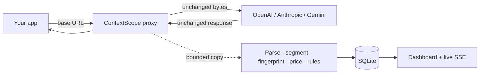

# ContextScope

**Understand every token. Debug every prompt. Optimize every AI request.**

ContextScope is a local, privacy-first reverse proxy and dashboard for LLM API calls. Point your app's base URL at it
and see where every token goes, whether the provider's prompt cache is actually hitting, what each request costs, and
what to change to make it cheaper and faster. It passes requests and responses through byte for byte and runs nothing
in the cloud.


## Why

When your app talks to OpenAI, Anthropic or Gemini, you pay per token but rarely see what you send. Tool definitions
quietly take up 40% of every request, a timestamp at the top of the system prompt breaks caching on every call, and the
bill keeps growing. ContextScope makes this visible without changing your code. Only the base URL changes.

## Features

- **Context breakdown.** Every request is split into segments (system prompt, tools, history, files, images, the latest
  message) with a token count for each, so you can see what fills the context window.
- **Prompt cache debugger.** Compares each request with the previous ones and shows where the shared prefix stops
  matching and why the cache missed (reordered tools, a dynamic value early in the prompt, a model switch…).
- **Costs.** Per request, session, model and day, from cached, uncached, cache-write and output tokens. Unknown models
  show *Pricing unavailable*, never a fake $0. You can edit prices in Settings.
- **Latency.** Time to first token, total duration and the proxy's own overhead.
- **Optimization findings.** Rules that point out repeated blocks, oversized tools, cache-unfriendly ordering and
  similar issues, with evidence and an estimated saving.
- **Request inspector and compare.** Open any request, read its segments, or diff two requests side by side.
- **Live.** New requests show up in the dashboard immediately, over SSE.
- **Sessions.** Group related calls with the optional `x-contextscope-session` header. The header is stripped before
  the request is forwarded.
- **Offline import.** `contextscope import` analyzes trace files without sending anything anywhere.

| Request inspector | Cache | Optimizations |
|---|---|---|
|  |  |  |

## Supported providers

| Provider | Endpoints | Base URL through ContextScope |
|---|---|---|
| OpenAI (and OpenAI-compatible) | `/v1/responses`, `/v1/chat/completions` | `http://127.0.0.1:3377/openai/v1` |
| Anthropic | `/v1/messages` | `http://127.0.0.1:3377/anthropic` |
| Google Gemini | `generateContent`, `streamGenerateContent` | `http://127.0.0.1:3377/gemini` |

JSON and streaming (SSE) responses are both supported. Other OpenAI-protocol upstreams (Groq, OpenRouter, a local
server…) can be added as `customProviders`. See [docs/providers.md](docs/providers.md).

## Quick start

Requirements: **Node.js ≥ 22.12** and **pnpm** (via corepack).

```sh
git clone <this repository>
cd contextscope
corepack enable
pnpm install
pnpm build
```

Try it with synthetic data first (no API keys needed):

```sh
pnpm demo        # → http://127.0.0.1:3377
```

Then run it for real:

```sh
pnpm start       # proxy + dashboard on http://127.0.0.1:3377
```

### Point your app at it

**OpenAI (Node):**

```js
import OpenAI from 'openai';

const client = new OpenAI({ baseURL: 'http://127.0.0.1:3377/openai/v1' });
const res = await client.responses.create({ model: 'gpt-5.6-mini', input: 'Hello!' });
```

**Anthropic (Node):**

```js
import Anthropic from '@anthropic-ai/sdk';

const client = new Anthropic({ baseURL: 'http://127.0.0.1:3377/anthropic' });
```

**Gemini (curl):**

```sh
curl "http://127.0.0.1:3377/gemini/v1beta/models/gemini-2.5-flash:generateContent" \
  -H "x-goog-api-key: $GEMINI_API_KEY" -H "content-type: application/json" \
  -d '{"contents":[{"parts":[{"text":"Hello!"}]}]}'
```

Your API key goes to the provider unchanged and is never stored. More in [examples/](examples/README.md).

### Docker

```sh
CONTEXTSCOPE_AUTH_TOKEN=$(openssl rand -hex 24) docker compose up -d
```

The container listens on `127.0.0.1:3377` only. For remote access put a TLS-terminating reverse proxy in front of it,
see [docs/deployment.md](docs/deployment.md).

## CLI

| Command | What it does |
|---|---|
| `contextscope start` | start the proxy and dashboard |
| `contextscope demo` | start with synthetic data in a separate data dir |
| `contextscope import <file>` | import a trace file offline |
| `contextscope export` | export stored records as JSON (metadata, no secrets) |
| `contextscope status` / `stop` | check or stop a running instance |
| `contextscope doctor` | check Node, data dir, SQLite, port, dashboard and config |
| `contextscope config` | print the effective configuration and where each value comes from |

In this repository run it as `node packages/cli/dist/bin.js <command>`.

## Privacy

- Everything runs on your machine. There is no telemetry.
- By default (`metadata` mode) **no prompt or response text is stored**, only sizes, usage, timings, costs and keyed
  fingerprints.
- Optional `deep_memory` keeps content in RAM only. Optional `deep_persistent` stores it encrypted with AES-256-GCM and
  deletes it after 24 h.
- API keys (`authorization`, `x-api-key`, `x-goog-api-key`, `?key=`) are removed before logs, the database, exports and
  error messages.

Details in [docs/privacy.md](docs/privacy.md) and [SECURITY.md](SECURITY.md).

## Configuration

Precedence: CLI flags > `CONTEXTSCOPE_*` environment variables > `contextscope.config.json` > defaults.

| Option | Environment | Default |
|---|---|---|
| port | `CONTEXTSCOPE_PORT` | `3377` |
| host | `CONTEXTSCOPE_HOST` | `127.0.0.1` |
| data dir | `CONTEXTSCOPE_DATA_DIR` | `./.contextscope` |
| capture mode | `CONTEXTSCOPE_CAPTURE_MODE` | `metadata` |
| auth token | `CONTEXTSCOPE_AUTH_TOKEN` | none (required on non-loopback hosts) |

Full list in [docs/configuration.md](docs/configuration.md).

## Performance

The proxy never waits for analysis. Bytes are piped straight to the client, and a bounded copy is analyzed on a side
channel and written to SQLite in batches. Measured with `pnpm bench` (Node 22, small JSON responses, local mock
upstream):

| Scenario | Overhead added by ContextScope |
|---|---|
| Sequential requests, p50 | ~3.7 ms |
| 100 req/s, p50 / p99 | ~1.7 ms / ~3.2 ms |
| Saturated, 20 concurrent | ≈ 480 req/s per process |

Real LLM calls take hundreds of milliseconds or more, so the overhead is negligible in practice. See
[docs/ARCHITECTURE.md](docs/ARCHITECTURE.md#performance).

## How it works



## Project structure

```
apps/server            Fastify proxy, analysis pipeline, REST API, SSE
apps/web               React + Vite + Tailwind dashboard
packages/core          segments, fingerprints, redaction
packages/providers     OpenAI / Anthropic / Gemini adapters and stream parsers
packages/analyzer      prefix comparison and optimization rules
packages/pricing       model prices and cost calculation
packages/cli           the `contextscope` command
packages/shared        shared types, config schema
packages/test-fixtures synthetic fixtures and demo data
docs/                  architecture, API, providers, token accounting, privacy, deployment
examples/              SDK and curl examples
```

Tech stack: TypeScript, pnpm workspaces, Fastify, SQLite (WAL) + Drizzle, Zod, Pino, Vitest, React, Vite, Tailwind,
Radix, TanStack Query, Recharts.

## Development

```sh
pnpm lint && pnpm typecheck
pnpm test          # server and package tests (Vitest)
pnpm test:web      # dashboard tests
pnpm test:e2e      # end-to-end smoke test (after pnpm build)
pnpm bench         # proxy overhead benchmark (after pnpm build)
```

See [CONTRIBUTING.md](CONTRIBUTING.md) for the architecture overview, how to add a provider or an optimization rule,
and the release process.

## License

[MIT](LICENSE)
