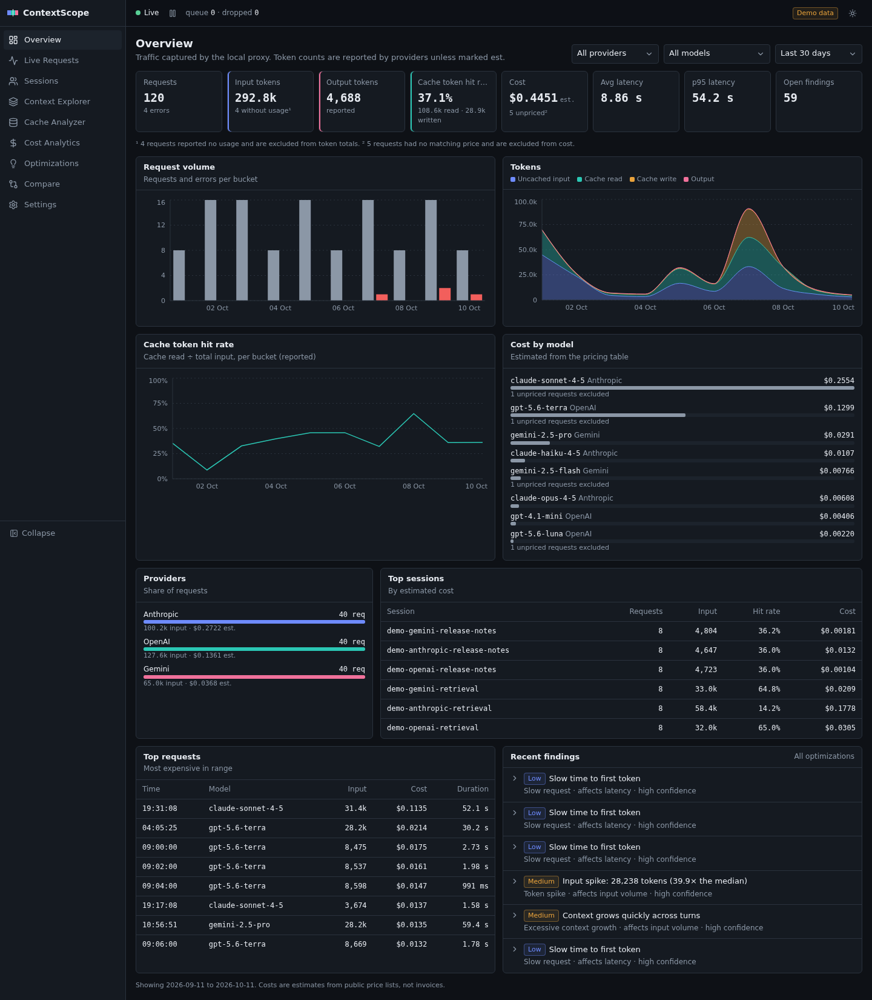
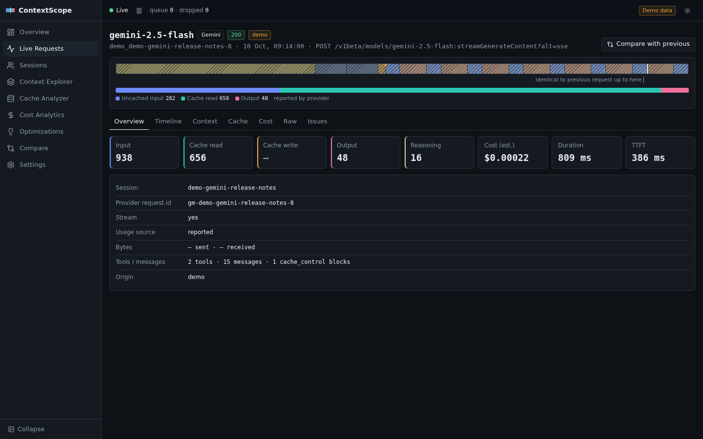
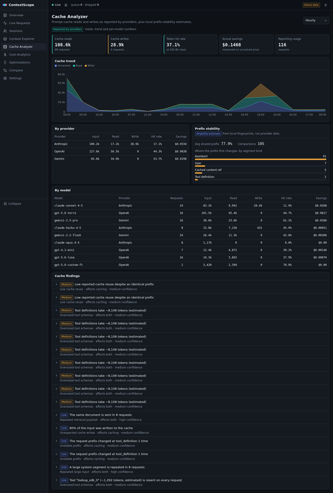
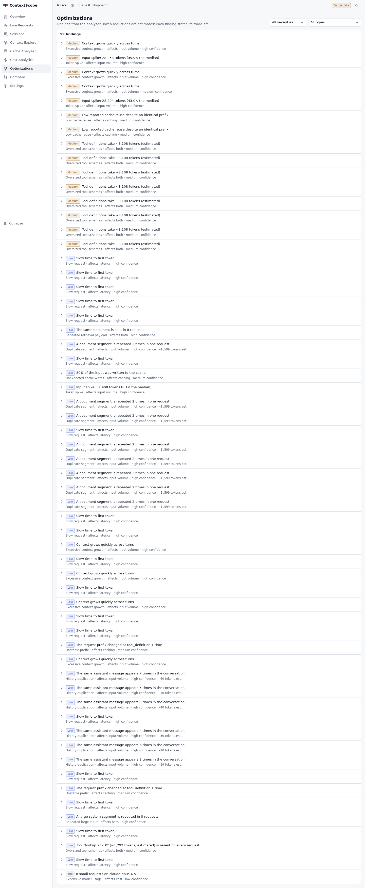
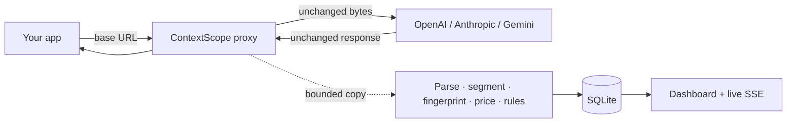

<div align="center">

# 🔭 ContextScope

### Understand every token. Debug every prompt. Optimize every AI request.

**A local, privacy-first reverse proxy + dashboard for LLM API calls.**<br>
Change one base URL — see where every token goes, why your cache misses, and what each call really costs.

[](https://github.com/brstic/ContextScope/actions/workflows/ci.yml)
[](LICENSE)


[](https://ahoy.sparkcan.com)

[Quick start](#-quick-start) · [Features](#-features) · [Providers](#-supported-providers) · [Privacy](#-privacy) · [Docs](#-documentation)

<br>



</div>

---

## 🤔 Why ContextScope?

When your app talks to OpenAI, Anthropic or Gemini, you pay per token — but you rarely see what you actually send.

| 😩 Without ContextScope | 😎 With ContextScope |
|---|---|
| Tool definitions silently eat 40% of every request | Per-segment token breakdown of every call |
| A timestamp at the top of the prompt breaks caching on every call | Cache debugger shows exactly where the prefix stopped matching — and why |
| The bill grows and nobody knows which feature causes it | Cost per request, session, model and day |
| "Why is it slow?" | Time to first token, total duration and proxy overhead |
| Guessing what to optimize | Concrete findings with evidence and estimated savings |

> [!TIP]
> **Zero code changes.** Your requests and responses pass through **byte for byte**. Only the base URL changes.

---

## ✨ Features

| | Feature | What you get |
|---|---|---|
| 🧩 | **Context breakdown** | Each request split into segments — system prompt, tools, history, files, images, latest message — with token counts |
| 🗄️ | **Prompt cache debugger** | Compares each request with previous ones and pinpoints why the cache missed (reordered tools, dynamic values, model switch…) |
| 💸 | **Cost tracking** | Cached, uncached, cache-write and output tokens priced per request / session / model / day. Unknown models show *Pricing unavailable* — never a fake `$0` |
| ⏱️ | **Latency** | Time to first token, total duration, and ContextScope's own overhead |
| 💡 | **Optimization findings** | Rules flag repeated blocks, oversized tools, cache-unfriendly ordering — with evidence and estimated savings |
| 🔍 | **Inspector & compare** | Open any request, browse its segments, or diff two requests side by side |
| ⚡ | **Live view** | New requests appear instantly over SSE |
| 🧵 | **Sessions** | Group calls with the optional `x-contextscope-session` header (stripped before forwarding) |
| 📦 | **Offline import** | `contextscope import` analyzes trace files without sending anything anywhere |

<table>
  <tr>
    <td align="center"><b>🔍 Request inspector</b></td>
    <td align="center"><b>🗄️ Cache debugger</b></td>
    <td align="center"><b>💡 Optimizations</b></td>
  </tr>
  <tr>
    <td></td>
    <td></td>
    <td></td>
  </tr>
</table>

---

## 🔌 Supported providers

| Provider | Endpoints | Base URL through ContextScope |
|---|---|---|
| 🟢 **OpenAI** (and compatible) | `/v1/responses`, `/v1/chat/completions` | `http://127.0.0.1:3377/openai/v1` |
| 🟠 **Anthropic** | `/v1/messages` | `http://127.0.0.1:3377/anthropic` |
| 🔵 **Google Gemini** | `generateContent`, `streamGenerateContent` | `http://127.0.0.1:3377/gemini` |

✅ JSON and streaming (SSE) responses &nbsp;·&nbsp; ✅ Other OpenAI-protocol upstreams (Groq, OpenRouter, local servers…) via `customProviders` — see [docs/providers.md](docs/providers.md)

---

## 🚀 Quick start

> **Requirements:** Node.js ≥ 22.12 and pnpm (via corepack)

```sh
git clone https://github.com/brstic/ContextScope.git
cd ContextScope
corepack enable
pnpm install
pnpm build
```

**1️⃣ Try the demo** — synthetic data, no API keys needed:

```sh
pnpm demo        # → http://127.0.0.1:3377
```

**2️⃣ Run it for real:**

```sh
pnpm start       # proxy + dashboard on http://127.0.0.1:3377
```

**3️⃣ Point your app at it:**

<details open>
<summary><b>🟢 OpenAI (Node)</b></summary>

```js
import OpenAI from 'openai';

const client = new OpenAI({ baseURL: 'http://127.0.0.1:3377/openai/v1' });
const res = await client.responses.create({ model: 'gpt-5.6-mini', input: 'Hello!' });
```
</details>

<details>
<summary><b>🟠 Anthropic (Node)</b></summary>

```js
import Anthropic from '@anthropic-ai/sdk';

const client = new Anthropic({ baseURL: 'http://127.0.0.1:3377/anthropic' });
```
</details>

<details>
<summary><b>🔵 Gemini (curl)</b></summary>

```sh
curl "http://127.0.0.1:3377/gemini/v1beta/models/gemini-2.5-flash:generateContent" \
  -H "x-goog-api-key: $GEMINI_API_KEY" -H "content-type: application/json" \
  -d '{"contents":[{"parts":[{"text":"Hello!"}]}]}'
```
</details>

🔑 Your API key goes to the provider unchanged and is **never stored**. More in [examples/](examples/README.md).

### 🐳 Docker

```sh
CONTEXTSCOPE_AUTH_TOKEN=$(openssl rand -hex 24) docker compose up -d
```

The container listens on `127.0.0.1:3377` only. For remote access, put a TLS-terminating reverse proxy in front — see [docs/deployment.md](docs/deployment.md).

---

## 🧠 How it works



The proxy **never waits for analysis**: bytes are piped straight to the client, and a bounded copy is analyzed on a side channel and written to SQLite in batches.

---

## ⚡ Performance

Measured with `pnpm bench` (Node 22, small JSON responses, local mock upstream):

| Scenario | Overhead added by ContextScope |
|---|---|
| 🐢 Sequential requests, p50 | **~3.7 ms** |
| 🚶 100 req/s, p50 / p99 | **~1.7 ms / ~3.2 ms** |
| 🏎️ Saturated, 20 concurrent | **≈ 480 req/s** per process |

Real LLM calls take hundreds of milliseconds or more, so the overhead is negligible in practice. Details in [docs/ARCHITECTURE.md](docs/ARCHITECTURE.md#performance).

---

## 🔒 Privacy

| | |
|---|---|
| 🏠 **100% local** | Everything runs on your machine. No cloud, no telemetry. |
| 📊 **Metadata by default** | In `metadata` mode **no prompt or response text is stored** — only sizes, usage, timings, costs and keyed fingerprints |
| 🧠 **`deep_memory`** | Optional: content kept in RAM only |
| 🔐 **`deep_persistent`** | Optional: content stored encrypted (AES-256-GCM) and deleted after 24 h |
| 🧹 **Key redaction** | `authorization`, `x-api-key`, `x-goog-api-key` and `?key=` are removed from logs, the database, exports and error messages |

Details in [docs/privacy.md](docs/privacy.md) and [SECURITY.md](SECURITY.md).

---

## 🛠️ CLI

| Command | What it does |
|---|---|
| `contextscope start` | ▶️ Start the proxy and dashboard |
| `contextscope demo` | 🎭 Start with synthetic data in a separate data dir |
| `contextscope import <file>` | 📥 Import a trace file offline |
| `contextscope export` | 📤 Export stored records as JSON (metadata, no secrets) |
| `contextscope status` / `stop` | 🩺 Check or stop a running instance |
| `contextscope doctor` | 🧪 Check Node, data dir, SQLite, port, dashboard and config |
| `contextscope config` | ⚙️ Print the effective config and where each value comes from |

> In this repository run it as `node packages/cli/dist/bin.js <command>`.

---

## ⚙️ Configuration

Precedence: **CLI flags** › **`CONTEXTSCOPE_*` env vars** › **`contextscope.config.json`** › **defaults**

| Option | Environment | Default |
|---|---|---|
| port | `CONTEXTSCOPE_PORT` | `3377` |
| host | `CONTEXTSCOPE_HOST` | `127.0.0.1` |
| data dir | `CONTEXTSCOPE_DATA_DIR` | `./.contextscope` |
| capture mode | `CONTEXTSCOPE_CAPTURE_MODE` | `metadata` |
| auth token | `CONTEXTSCOPE_AUTH_TOKEN` | none (required on non-loopback hosts) |

Full list in [docs/configuration.md](docs/configuration.md).

---

## 🗂️ Project structure

```
apps/
  server/            🖥️  Fastify proxy, analysis pipeline, REST API, SSE
  web/               🎨  React + Vite + Tailwind dashboard
packages/
  core/              🧩  segments, fingerprints, redaction
  providers/         🔌  OpenAI / Anthropic / Gemini adapters and stream parsers
  analyzer/          💡  prefix comparison and optimization rules
  pricing/           💸  model prices and cost calculation
  cli/               🛠️  the `contextscope` command
  shared/            📐  shared types, config schema
  test-fixtures/     🧪  synthetic fixtures and demo data
docs/                📚  architecture, API, providers, privacy, deployment
examples/            🧑‍💻  SDK and curl examples
```

### 🧰 Tech stack

| Layer | Tools |
|---|---|
| Backend | TypeScript · Fastify · SQLite (WAL) · Drizzle · Zod · Pino |
| Frontend | React · Vite · Tailwind · Radix · TanStack Query · Recharts |
| Tooling | pnpm workspaces · Vitest · Playwright · ESLint · Prettier |

---

## 📚 Documentation

| Doc | Topic |
|---|---|
| [ARCHITECTURE.md](docs/ARCHITECTURE.md) | How the proxy, pipeline and storage fit together |
| [providers.md](docs/providers.md) | Supported providers and custom upstreams |
| [token-accounting.md](docs/token-accounting.md) | How tokens and cache usage are counted per provider |
| [configuration.md](docs/configuration.md) | All options |
| [privacy.md](docs/privacy.md) | Capture modes and what is stored |
| [deployment.md](docs/deployment.md) | Docker and remote access |
| [api.md](docs/api.md) | REST API |
| [troubleshooting.md](docs/troubleshooting.md) | Common problems |

---

## 🤝 Contributing

```sh
pnpm lint && pnpm typecheck
pnpm test          # server and package tests (Vitest)
pnpm test:web      # dashboard tests
pnpm test:e2e      # end-to-end smoke test (after pnpm build)
pnpm bench         # proxy overhead benchmark (after pnpm build)
```

PRs are welcome! 🎉 See [CONTRIBUTING.md](CONTRIBUTING.md) for how to add a provider or an optimization rule, and the release process.

---

<div align="center">

**[MIT](LICENSE)** · Made with ☕ and a lot of tokens

⛵ Proudly made with **[Ahoy](https://ahoy.sparkcan.com)**

⭐ If ContextScope saved you money, give it a star!

</div>
